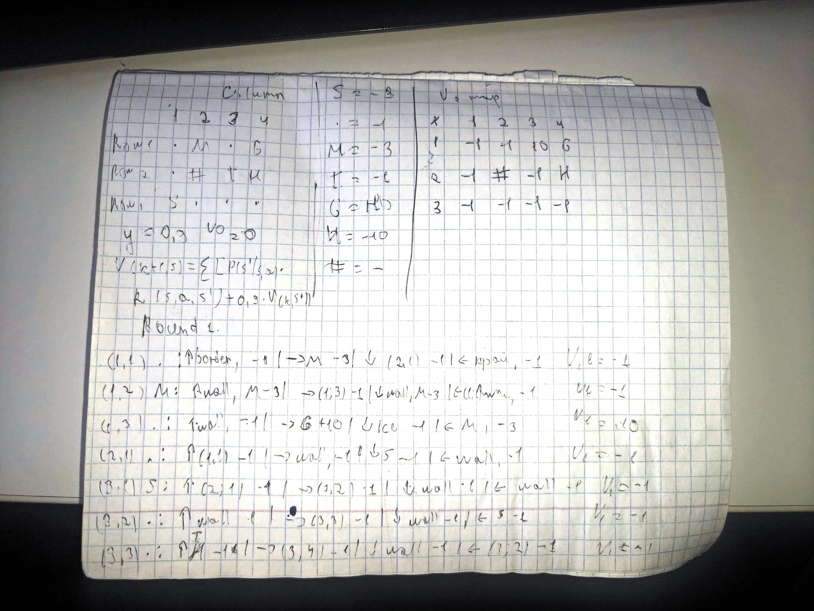
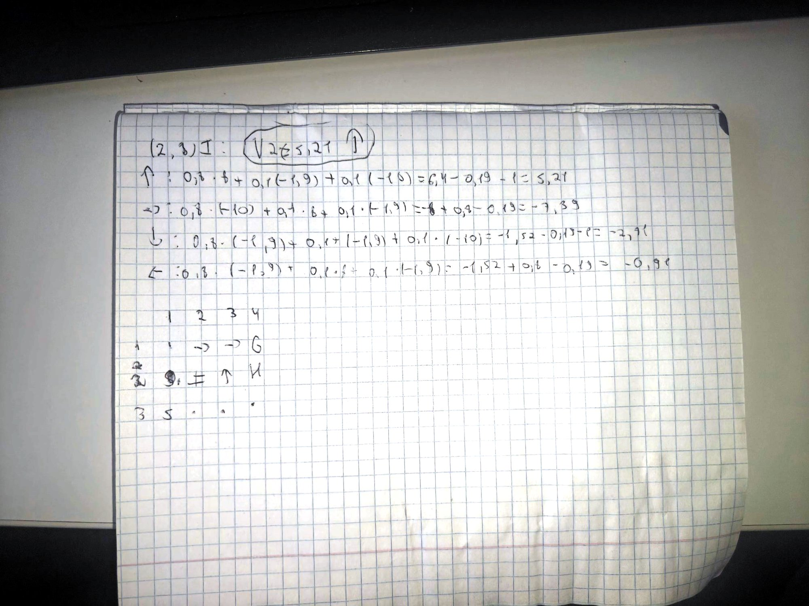

# HW6 submission

## AI-use declaration

* **Claude (Anthropic), Part A:** explained value iteration on separate practice maps; after I finished my own hand calculations it checked my numbers (they matched); rotated and brightened the photos of my pages; drafted the text of items 1 and 4, which I reviewed and can explain.
* **Claude (Anthropic), Part B:** listed where every action leads from every state using FrozenLake's own transition table, designed the fixed policy from it, and wrote the reasons in the policy table; I reviewed the choices and can explain the trade off at states 4, 6 and 8. After the policy was committed, Claude wrote `part_b/frozenlake.py`, ran the 600 episodes and drafted the Part B explanations from the saved results.
* **Claude (Anthropic), Part C:** wrote the value iteration solver, the rule checks and the simulator (`part_c/`).

## Setup and reproduction

Versions used for the saved results: Python 3.13.18, gymnasium 1.4.0, numpy 2.5.3 (pinned in [requirements.txt](requirements.txt)). No API key is needed.

macOS / Linux, from the repository root:

```bash
python3 -m venv .venv
source .venv/bin/activate
python -m pip install -r requirements.txt
```

Windows PowerShell: `python -m venv .venv`, then `.venv\Scripts\Activate.ps1`, then the same `pip install`.

**Part B:** `python part_b/frozenlake.py` runs all 600 episodes and rewrites the files in `outputs/` starting with `part_b_`. The run is deterministic: the same seeds give the same table.

**Part C:** `python part_c/run_part_c.py` runs the rule checks, the comparison with my paper values, value iteration on both maps and the simulations, and rewrites the files in `outputs/` starting with `part_c_`. It only needs numpy; it is also deterministic.

## Part A — Paper calculations

Hand calculations, photographed and committed before any code was written.

* Page 1: map, rewards, update rule and V1 for every nonterminal tile, with the V1 map: [part_a/part_a_page1.jpg](part_a/part_a_page1.jpg)
* Page 2: V1 at the ice tile (2,3), round 2 setup and V2 at (1,2) and (1,3): [part_a/part_a_page2.jpg](part_a/part_a_page2.jpg)
* Page 3: V2 at the ice tile (2,3) with all four probability weighted sums, and the arrow map: [part_a/part_a_page3.jpg](part_a/part_a_page3.jpg)





### V1 (typed copy of page 1)

| Row | Col 1 | Col 2 | Col 3 | Col 4 |
| --- | --- | --- | --- | --- |
| 1 | -1 | -1 (M) | 10 | G |
| 2 | -1 | # | -1 (I) | H |
| 3 | -1 (S) | -1 | -1 | -1 |

### V2 at the three requested tiles (typed copy of pages 2 and 3)

| Tile | Up | Right | Down | Left | V2 | Best action |
| --- | --- | --- | --- | --- | --- | --- |
| (1,2) mud | -3.9 (edge, stay in mud) | 8 (to (1,3)) | -3.9 (wall, stay in mud) | -1.9 (to (1,1)) | 8 | right, no tie |
| (1,3) floor | 8 (edge, stay on (1,3)) | 10 (to G) | -1.9 (to ice) | -3.9 (to mud) | 10 | right, no tie |
| (2,3) ice | 0.8·8 + 0.1·(-1.9) + 0.1·(-10) = 5.21 | 0.8·(-10) + 0.1·8 + 0.1·(-1.9) = -7.39 | 0.8·(-1.9) + 0.1·(-1.9) + 0.1·(-10) = -2.71 | 0.8·(-1.9) + 0.1·8 + 0.1·(-1.9) = -0.91 | 5.21 | up, no tie |

### Item 1: the MDP in my own words

* **States:** every tile the agent can stand on. The map has 12 tiles; the wall (2,2) is not a state, so there are 11 states. Two of them are terminal: the goal G (1,4) and the hole H (2,4). The other 9 are nonterminal, and those are the tiles I calculated.
* **Actions:** up, right, down and left in every nonterminal state. Terminal states have no actions, because the episode is over.
* **Transitions:** from S, ordinary floor and mud the chosen move always happens. From ice the move is uncertain: 0.8 in the chosen direction and 0.1 to each perpendicular side, and never backwards. If a move (or a slip) would go into the wall or off the map, the agent stays where it is. Each slip outcome is checked against walls and edges separately, so the probabilities of one action always add up to 1.
* **Rewards:** the agent receives the reward of the tile where the move ends: -1 for S, floor and ice, -3 for mud, +10 for the goal and -10 for the hole. Bumping into a wall still costs the reward of the tile it stays on, so bumping from mud costs -3. After G or H there are no more rewards, so their values stay 0.
* **What the agent maximizes:** the expected discounted sum of rewards, r0 + 0.9·r1 + 0.9²·r2 + ... "Expected" matters because ice is random, so an action is judged by the probability weighted average of its outcomes. The discount 0.9 makes a reward now worth more than the same reward later, so the agent prefers to reach the goal by a short, cheap path while avoiding mud and the hole.

### Item 4: arrows, ties and why two rounds are not enough

Arrows at the requested tiles: (1,2) right, (1,3) right, (2,3) up. At these three tiles there are no ties: each maximum is reached by one action only.

Two rounds do not prove that this is the final optimal policy:

1. **V2 only looks two moves ahead.** V2 is the best expected return if the agent had exactly two moves left, but in this problem the episode continues until the agent reaches G or H, with no move limit.
2. **The goal has not reached most of the map yet.** Each round spreads information about the goal by about one tile. After two rounds only (1,2), (1,3) and the ice (2,3) have positive values. The start (3,1) and the whole third row still have V2 = -1.9, and at the start all four actions tie, so V2 gives no useful direction there yet.
3. **The best action already changed once, so it can change again.** At the ice tile the best action in round 1 was left (bump into the wall and stay, -1, the safest single move), but in round 2 it became up (5.21), because (1,3) now "knows" about the goal. Values and arrows keep moving in V3, V4 and later rounds.
4. **Optimality needs converged values.** The policy is optimal only after the values stop changing, which is what Part C checks: run value iteration until the largest change in a full update is below 0.000001, then choose the best action at every tile from those final values.

## Part B — FrozenLake

### Fixed policy, written before the experiments

Committed before any FrozenLake code or experiment. The same table is used, unchanged, in all four conditions; the code reads it from [part_b/fixed_policy.json](part_b/fixed_policy.json).

Gymnasium action numbers: 0 = left, 1 = down, 2 = right, 3 = up. States are numbered row × 4 + column:

```text
  0 S |  1 F |  2 F |  3 F
  4 F |  5 H |  6 F |  7 H
  8 F |  9 F | 10 F | 11 H
 12 H | 13 F | 14 F | 15 G
```

| State | Action | Without slipping | With slipping (each outcome 1/3) | Reason |
| --- | --- | --- | --- | --- |
| 0 | down (1) | to 4 | 0, 1 or 4, no hole | first step of the main path, safe in both modes |
| 1 | up (3) | stays on 1 | 0, 1 or 2, no hole | off the path: pressing against the top edge is the only action with no hole risk; slips drift back towards 0 |
| 2 | up (3) | stays on 2 | 1, 2 or 3, no hole | off the path: same top edge trick, avoids state 6 completely |
| 3 | up (3) | stays on 3 | 2 or 3, no hole | off the path: every other action can slip into hole 7 |
| 4 | down (1) | to 8 | 4, 5 (hole) or 8 | on the main path; the only safe action (left) would leave the agent stuck on 4 forever without slipping, so I accept a 1/3 hole risk |
| 6 | left (0) | to 5 (hole) | 2, 5 (hole) or 10 | off the path and never reached without slipping; every action here has a hole risk, left and right have the smallest one (1/3 instead of 2/3), and both slips lead back to safer states |
| 8 | right (2) | to 9 | 4, 9 or 12 (hole) | on the main path; the only safe action (up) would send the agent back to 4 and loop forever without slipping, so I accept a 1/3 hole risk |
| 9 | down (1) | to 13 | 8, 10 or 13, no hole | on the main path, safe in both modes |
| 10 | left (0) | to 9 | 6, 9 or 14, no hole | off the path: the only action with no direct hole risk; it returns to the path at 9 or jumps ahead to 14 |
| 13 | right (2) | to 14 | 9, 13 or 14, no hole | on the main path, safe in both modes |
| 14 | right (2) | to 15 (goal) | 10, 14 or 15 (goal), no hole | last step; no outcome is a hole |

**Main path without slipping:** 0 → 4 → 8 → 9 → 13 → 14 → 15, six steps, no hole on the way. So without slipping I expect this policy to reach the goal in every episode.

**Trade off:** one table has to work in both modes. On the path, states 4 and 8 have no action that both moves forward and is safe when slipping, so I chose progress there and accepted a 1/3 hole risk per visit. Off the path I chose safety first: the top row presses into the top edge, so slips only move the agent sideways along the row until it reaches 0 and the main path. State 6 cannot be made safe, so it gets the smallest risk.

### Results

FrozenLake-v1, `map_name="4x4"`, default rewards, 100 step limit. Each batch: episode seeds 1000 × batch seed + i for i = 0..49, the same lists in all four conditions; the random policy uses `numpy.random.default_rng(episode_seed)`.

| Slippery? | Policy | Batch seed | Goals /50 | Holes /50 | Time limits /50 | Success % | Mean steps |
| --- | --- | --- | --- | --- | --- | --- | --- |
| no | random | 11 | 0 | 50 | 0 | 0% | 7.98 |
| no | random | 22 | 0 | 50 | 0 | 0% | 6.42 |
| no | random | 33 | 1 | 49 | 0 | 2% | 6.66 |
| no | fixed | 11 | 50 | 0 | 0 | 100% | 6.00 |
| no | fixed | 22 | 50 | 0 | 0 | 100% | 6.00 |
| no | fixed | 33 | 50 | 0 | 0 | 100% | 6.00 |
| yes | random | 11 | 0 | 50 | 0 | 0% | 8.30 |
| yes | random | 22 | 2 | 48 | 0 | 4% | 7.76 |
| yes | random | 33 | 0 | 50 | 0 | 0% | 6.74 |
| yes | fixed | 11 | 3 | 45 | 2 | 6% | 16.86 |
| yes | fixed | 22 | 4 | 45 | 1 | 8% | 22.78 |
| yes | fixed | 33 | 1 | 49 | 0 | 2% | 12.72 |

Files in `outputs/`:

* [part_b_episodes.csv](outputs/part_b_episodes.csv): 600 rows, one per episode (condition, slippery flag, policy, batch seed, episode seed, steps, total reward, final state, outcome).
* [part_b_summary.md](outputs/part_b_summary.md) and [part_b_summary.json](outputs/part_b_summary.json): the table above.
* [part_b_traces.txt](outputs/part_b_traces.txt): the first goal, hole and time limit episode of every condition, or a note when that outcome never happened.
* [part_b_example_episode.txt](outputs/part_b_example_episode.txt): one full episode with Gymnasium's text rendering (slippery, fixed policy, seed 11000).

**A successful trace** (not slippery, fixed policy, seed 11000), the planned path exactly:

```text
step 1: state  0 -- down--> state  4, reward 0
step 2: state  4 -- down--> state  8, reward 0
step 3: state  8 --right--> state  9, reward 0
step 4: state  9 -- down--> state 13, reward 0
step 5: state 13 --right--> state 14, reward 0
step 6: state 14 --right--> state 15, reward 1, terminated (goal)
```

**A failed trace** (slippery, random policy, seed 11000):

```text
step 1: state  0 --   up--> state  0, reward 0
step 2: state  0 --right--> state  4, reward 0   (slipped down)
step 3: state  4 -- down--> state  4, reward 0   (slipped left into the edge)
step 4: state  4 --   up--> state  5, reward 0, terminated (hole)
```

Outcomes that never happened: no hole with the fixed policy without slipping; no time limit in any condition except slippery with the fixed policy (3 episodes in total).

**What slipping changed.** Without slipping my fixed policy is perfect: 150 goals out of 150, always in 6 steps. With slipping it reaches the goal only 8 times out of 150 (2% to 8% per batch). Most failures are hole 5 (105 of 139 holes) and the rest are hole 12 (34). That matches the trade off I wrote before running: at state 4 I press down, and one time in three the agent slips right into hole 5; at state 8 I press right, and one time in three it slips down into hole 12; a slip from 8 back to 4 just gives hole 5 another chance. Slipping also makes episodes longer (mean 12.72 to 22.78 steps instead of 6), because the agent slides sideways and my top row actions (press up) only drift slowly back to the start. Three episodes even ran out of time while drifting along the top row (they ended on states 3 and 0). The random policy is bad in both modes (1 and 2 goals out of 150), so slipping barely changes it. The lesson for me: a policy that is safe on the deterministic path is not safe once moves are uncertain, and the safe actions at 4 and 8 (left at 4, up at 8) would loop forever without slipping, so no single table is good in both modes.

**How consistent the batches were.** Without slipping the fixed policy gives exactly the same result in all three batches (50/50, 6.00 steps), because nothing random happens and the seeds have nothing to change. Everything else varies: the random policy without slipping got 0, 0 and 1 goals, and the fixed policy with slipping got 3, 4 and 1 goals with mean steps from 12.72 to 22.78. With only 50 episodes per batch, a difference of 1 to 3 goals is within normal chance, so I would not say that one batch seed is "better"; that is why the task asks for three batches and not one.

**Why one successful episode is not enough.** Success here is a probability, not a fact about the policy. The random policy reached the goal in episode 33006 without slipping; if that had been the only episode I ran, the random policy would look perfect, while over 150 episodes it succeeded once. In the same way, one slippery success of my fixed policy (for example seed 11020) would hide the fact that it fails in 142 of 150 episodes (about 95%). Many episodes with fixed seeds are needed to estimate the success rate and to see how much it varies.

**Why these runs are not training.** Both policies were fixed before any episode: the random policy always picks uniformly, and the fixed policy is read from `part_b/fixed_policy.json`, committed before the code. Nothing in the program updates an action from rewards or outcomes, so episode 600 uses exactly the same rules as episode 1. These runs only measure how good two given policies are. Training would mean changing the policy from experience (for example Q learning) or computing a better policy from the model, which is what value iteration does in Part C.

## Part C — Custom solver

Code: [part_c/gridworld.py](part_c/gridworld.py) (model, value iteration, policy extraction) and [part_c/run_part_c.py](part_c/run_part_c.py) (checks, paper comparison, solving, simulation). Run everything with `python part_c/run_part_c.py`; it rewrites the files in `outputs/` starting with `part_c_` and gives the same results every time.

**Floor rules are data, not code.** Rewards, deterministic or slippery movement, the ice probabilities, terminal tiles and walls are read from `tiles` in [data/maps.json](data/maps.json). The solver never names a floor letter, so sand `D` and shallow water `W` needed no change to value iteration: the extended map simply uses their entries.

### Compare code with paper

The solver's V1 and V2 match my hand calculations exactly: 0 differences in all 9 V1 values and in all 12 action values of the three V2 tiles. Full output: [outputs/part_c_paper_comparison.txt](outputs/part_c_paper_comparison.txt).

V1 from the solver:

```text
             1       2       3       4
Row 1    -1.00   -1.00   10.00     G
Row 2    -1.00     #     -1.00     H
Row 3    -1.00   -1.00   -1.00   -1.00
```

| Tile | Up | Right | Down | Left | V2 (solver) | V2 (my paper) |
| --- | --- | --- | --- | --- | --- | --- |
| (1,2) mud | -3.9 | 8.0 | -3.9 | -1.9 | 8.0 | 8 |
| (1,3) floor | 8.0 | 10.0 | -1.9 | -3.9 | 10.0 | 10 |
| (2,3) ice | 5.21 | -7.39 | -2.71 | -0.91 | 5.21 | 5.21 |

There were no discrepancies to correct. The places where I could have gone wrong on paper, bumping from mud into the edge or the wall (-3, not -1), and the ice slip into the wall that keeps the agent on the ice, give the same numbers in code.

### Values, policies and convergence

| Map | Iterations | Largest change in the last full update | Converged | V(start) |
| --- | --- | --- | --- | --- |
| Paper map | 12 | 2.165e-07 | yes (below 0.000001, far from the 10,000 safeguard) | 1.5358 |
| Extended map | 11 | 2.406e-07 | yes | 1.5020 |

Full value maps, arrow maps and every Q value: [outputs/part_c_paper_map.txt](outputs/part_c_paper_map.txt) and [outputs/part_c_extended_map.txt](outputs/part_c_extended_map.txt).

Values include the discount 0.9: every value equals the reward of the best move plus 0.9 times the value of where it lands, for example V(1,2) = -1 + 0.9 · 10 = 8 and V(1,1) = -3 + 0.9 · 8 = 4.2. The letter in brackets is the tile type; G and H are terminal (value 0, no action).

**Paper map** `.M.G / .#IH / S...`

Final values:

| Row | Col 1 | Col 2 | Col 3 | Col 4 |
| --- | --- | --- | --- | --- |
| 1 | 4.200 (.) | 8.000 (M) | 10.000 (.) | G |
| 2 | 2.780 (.) | # | 5.824 (I) | H |
| 3 | 1.536 (S) | 2.818 (.) | 4.242 (.) | 2.818 (.) |

Policy:

| Row | Col 1 | Col 2 | Col 3 | Col 4 |
| --- | --- | --- | --- | --- |
| 1 | → | → | → | G |
| 2 | ↑ | # | ↑ | H |
| 3 | → | → | ↑ | ← |

Route from the start: S (3,1) → (3,2) → (3,3) → ice (2,3) → (1,3) → G.

**Extended map** `.M.G / .#IH / SD.W`

Final values:

| Row | Col 1 | Col 2 | Col 3 | Col 4 |
| --- | --- | --- | --- | --- |
| 1 | 4.200 (.) | 8.000 (M) | 10.000 (.) | G |
| 2 | 2.780 (.) | # | 5.824 (I) | H |
| 3 | 1.502 (S) | 2.818 (D) | 4.242 (.) | 2.818 (W) |

Policy:

| Row | Col 1 | Col 2 | Col 3 | Col 4 |
| --- | --- | --- | --- | --- |
| 1 | → | → | → | G |
| 2 | ↑ | # | ↑ | H |
| 3 | ↑ | → | ↑ | ← |

Route from the start: S (3,1) → (2,1) → (1,1) → mud (1,2) → (1,3) → G.

**Policy extraction and ties.** After convergence I compute Q(s, a) for all four actions from the final values and pick the largest. Tie rule: actions whose Q is within 1e-9 of the best count as tied, all of them are listed, and the first one in the order up, right, down, left is used. On both maps no best action was tied (the arrow maps in the output files would mark a tie with `*`), so the rule never had to decide.

### Simulation results

Each computed policy was simulated with my own simulator using the known model: 3 batches of 50 episodes, episode seed 1000 × batch seed + i (the Part B scheme), 100 step limit, `numpy.random.default_rng(episode_seed)` for the slips. Discounted return = r0 + 0.9·r1 + 0.9²·r2 + ...

| Map | Batch seed | Goals /50 | Holes /50 | Time limits /50 | Mean steps | Mean discounted return |
| --- | --- | --- | --- | --- | --- | --- |
| paper map | 11 | 47 | 3 | 0 | 5.04 | 2.230 |
| paper map | 22 | 44 | 6 | 0 | 4.96 | 1.442 |
| paper map | 33 | 42 | 8 | 0 | 4.88 | 0.970 |
| extended map | 11 | 50 | 0 | 0 | 5.00 | 1.502 |
| extended map | 22 | 50 | 0 | 0 | 5.00 | 1.502 |
| extended map | 33 | 50 | 0 | 0 | 5.00 | 1.502 |

Per episode rows: [outputs/part_c_episodes.csv](outputs/part_c_episodes.csv); everything in one file: [outputs/part_c_summary.json](outputs/part_c_summary.json).

### Explain your results

**What changed with sand and water.** Rows 1 and 2 are identical on both maps: same values, same arrows. The only change that matters is at the start (3,1). On the paper map the best route is along the bottom row and then up over the ice: S → (3,2) → (3,3) → ice → (1,3) → G. On the extended map the first step of that route now enters sand (-2 instead of -1), so Q(start, right) drops from 1.5358 to 0.5358 and the start switches to up: S → (2,1) → (1,1) → mud → (1,3) → G. V(start) falls only a little, from 1.5358 to 1.5020, because the agent simply takes the other route. Water at (3,4) changes nothing on the chosen route: it only makes Q((3,3), right) much worse (-2.4642 instead of 1.5358), and that action was never chosen anyway. The arrows on D and W themselves are what to do if the agent ever stands there; the value of a tile is about leaving it, and the floor cost is paid when entering it.

**Where cost and risk mattered.** On the paper map the two routes are almost equal: right is worth 1.5358 and up is worth 1.5020 at the start. The bottom route is cheaper (no mud) but risky, because it crosses the ice next to the hole: from the ice, "up" slips right into H with probability 0.1 and slips into the wall (stay and try again) with probability 0.1, so the chance of ending in the hole is 0.1 / 0.9 ≈ 11%. The top route is safe but pays -3 for the mud. Value iteration weighs both, and the cheap but risky route wins by only 0.034. Adding sand (an extra cost of 1 on the bottom route) is enough to flip the choice to the safe route. In the simulations this is very visible: 17 holes out of 150 (11.3%, close to the 11.1% from the model) on the paper map, and 0 holes out of 150 on the extended map.

**How the policy handled ice.** On the paper map the policy uses the ice but chooses "up" there (Q = 5.8242), the action whose intended move goes to (1,3) and whose sideways slips are one wall (harmless) and one hole (10%). "Right" from the ice would go straight into the hole with probability 0.8 (Q = -6.9182). On the extended map the ice is still on the map with the same arrow, but the optimal route never visits it.

**How the simulations relate to the computed values.** V(start) is an expected value over an infinite horizon; a simulation is a finite sample from 150 episodes with a 100 step limit. The 100 step limit hardly matters here: every episode ended within a few steps (no time limits) and 0.9^100 ≈ 0.00003, so rewards after step 100 would barely count. The real difference is sampling. On the paper map each episode is either a goal with return between 1.81 and 3.12 or a hole with return -10, so the batch means jump around (2.230, 1.442, 0.970) depending on how many holes happened (3, 6, 8), while the mean over all 150 episodes, 1.547, is close to V(start) = 1.536. On the extended map the chosen route is fully deterministic, so every episode returns exactly -1 - 0.9 - 3·0.81 - 0.729 + 10·0.6561 = 1.502, which equals V(start). So the simulations estimate the values; they are not the same thing, and the estimate is only exact when nothing random happens.

### Rule checks

All 24 checks pass; the full output is saved in [outputs/part_c_rule_checks.txt](outputs/part_c_rule_checks.txt) and is regenerated on every run.

* **Walls and edges:** (1,2) mud up (edge) and down (wall) stay on (1,2) with reward -3; (2,1) right into the wall, (3,1) left and down, (1,1) up all stay in place with reward -1.
* **Ice probabilities:** every ice action has outcomes 0.8, 0.1 and 0.1 that sum to 1; for example ice up gives 0.8 to (1,3), 0.1 stays on the ice (left slip hits the wall), 0.1 into the hole (2,4). Every action from every nonterminal state on both maps sums to 1.
* **Floor rewards:** entering mud gives -3, sand -2, shallow water -5, ordinary floor -1, the goal exactly +10 (no extra floor cost) and the hole -10; sand and water moves are deterministic.
* **Termination:** G and H return no outcomes (no actions, no further rewards), their values stay 0 in every round, and a simulated episode stops on the move that enters G or H.

