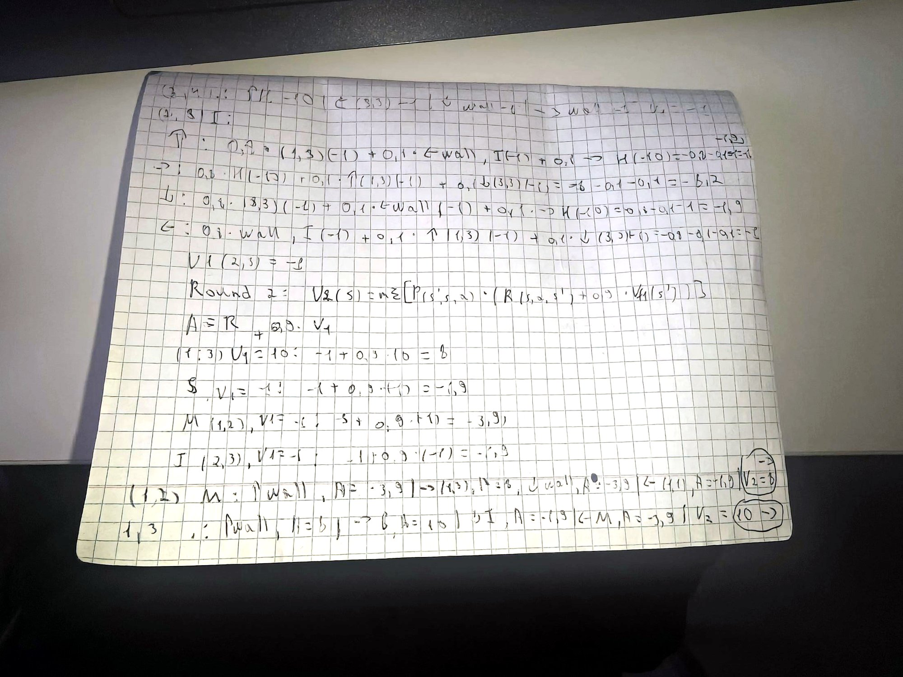

# HW6 submission

## AI-use declaration

TODO(you): check that this is true and add Parts B and C when they are done.

* **Claude (Anthropic), Part A:** explained value iteration on separate practice maps; after I finished my own hand calculations it checked my numbers (they matched); rotated and brightened the photos of my pages; drafted the text of items 1 and 4, which I reviewed and can explain.
* **Claude (Anthropic), Part B:** listed where every action leads from every state using FrozenLake's own transition table, designed the fixed policy from it, and wrote the reasons in the policy table; I reviewed the choices and can explain the trade off at states 4, 6 and 8.

## Setup and reproduction

Record dependency versions, installation commands and exact run commands.

## Part A — Paper calculations

Hand calculations, photographed and committed before any code was written.

* Page 1: map, rewards, update rule and V1 for every nonterminal tile, with the V1 map: [part_a/part_a_page1.jpg](part_a/part_a_page1.jpg)
* Page 2: V1 at the ice tile (2,3), round 2 setup and V2 at (1,2) and (1,3): [part_a/part_a_page2.jpg](part_a/part_a_page2.jpg)
* Page 3: V2 at the ice tile (2,3) with all four probability weighted sums, and the arrow map: [part_a/part_a_page3.jpg](part_a/part_a_page3.jpg)





### V1 (typed copy of page 1)

| Row | Col 1 | Col 2 | Col 3 | Col 4 |
| --- | --- | --- | --- | --- |
| 1 | -1 | -1 (M) | 10 | G |
| 2 | -1 | # | -1 (I) | H |
| 3 | -1 (S) | -1 | -1 | -1 |

### V2 at the three requested tiles (typed copy of pages 2 and 3)

| Tile | Up | Right | Down | Left | V2 | Best action |
| --- | --- | --- | --- | --- | --- | --- |
| (1,2) mud | -3.9 (edge, stay in mud) | 8 (to (1,3)) | -3.9 (wall, stay in mud) | -1.9 (to (1,1)) | 8 | right, no tie |
| (1,3) floor | 8 (edge, stay on (1,3)) | 10 (to G) | -1.9 (to ice) | -3.9 (to mud) | 10 | right, no tie |
| (2,3) ice | 0.8·8 + 0.1·(-1.9) + 0.1·(-10) = 5.21 | 0.8·(-10) + 0.1·8 + 0.1·(-1.9) = -7.39 | 0.8·(-1.9) + 0.1·(-1.9) + 0.1·(-10) = -2.71 | 0.8·(-1.9) + 0.1·8 + 0.1·(-1.9) = -0.91 | 5.21 | up, no tie |

### Item 1: the MDP in my own words

* **States:** every tile the agent can stand on. The map has 12 tiles; the wall (2,2) is not a state, so there are 11 states. Two of them are terminal: the goal G (1,4) and the hole H (2,4). The other 9 are nonterminal, and those are the tiles I calculated.
* **Actions:** up, right, down and left in every nonterminal state. Terminal states have no actions, because the episode is over.
* **Transitions:** from S, ordinary floor and mud the chosen move always happens. From ice the move is uncertain: 0.8 in the chosen direction and 0.1 to each perpendicular side, and never backwards. If a move (or a slip) would go into the wall or off the map, the agent stays where it is. Each slip outcome is checked against walls and edges separately, so the probabilities of one action always add up to 1.
* **Rewards:** the agent receives the reward of the tile where the move ends: -1 for S, floor and ice, -3 for mud, +10 for the goal and -10 for the hole. Bumping into a wall still costs the reward of the tile it stays on, so bumping from mud costs -3. After G or H there are no more rewards, so their values stay 0.
* **What the agent maximizes:** the expected discounted sum of rewards, r0 + 0.9·r1 + 0.9²·r2 + ... "Expected" matters because ice is random, so an action is judged by the probability weighted average of its outcomes. The discount 0.9 makes a reward now worth more than the same reward later, so the agent prefers to reach the goal by a short, cheap path while avoiding mud and the hole.

### Item 4: arrows, ties and why two rounds are not enough

Arrows at the requested tiles: (1,2) right, (1,3) right, (2,3) up. At these three tiles there are no ties: each maximum is reached by one action only.

Two rounds do not prove that this is the final optimal policy:

1. **V2 only looks two moves ahead.** V2 is the best expected return if the agent had exactly two moves left, but in this problem the episode continues until the agent reaches G or H, with no move limit.
2. **The goal has not reached most of the map yet.** Each round spreads information about the goal by about one tile. After two rounds only (1,2), (1,3) and the ice (2,3) have positive values. The start (3,1) and the whole third row still have V2 = -1.9, and at the start all four actions tie, so V2 gives no useful direction there yet.
3. **The best action already changed once, so it can change again.** At the ice tile the best action in round 1 was left (bump into the wall and stay, -1, the safest single move), but in round 2 it became up (5.21), because (1,3) now "knows" about the goal. Values and arrows keep moving in V3, V4 and later rounds.
4. **Optimality needs converged values.** The policy is optimal only after the values stop changing, which is what Part C checks: run value iteration until the largest change in a full update is below 0.000001, then choose the best action at every tile from those final values.

## Part B — FrozenLake

### Fixed policy, written before the experiments

Committed before any FrozenLake code or experiment. The same table is used, unchanged, in all four conditions; the code reads it from [part_b/fixed_policy.json](part_b/fixed_policy.json).

Gymnasium action numbers: 0 = left, 1 = down, 2 = right, 3 = up. States are numbered row × 4 + column:

```text
  0 S |  1 F |  2 F |  3 F
  4 F |  5 H |  6 F |  7 H
  8 F |  9 F | 10 F | 11 H
 12 H | 13 F | 14 F | 15 G
```

| State | Action | Without slipping | With slipping (each outcome 1/3) | Reason |
| --- | --- | --- | --- | --- |
| 0 | down (1) | to 4 | 0, 1 or 4, no hole | first step of the main path, safe in both modes |
| 1 | up (3) | stays on 1 | 0, 1 or 2, no hole | off the path: pressing against the top edge is the only action with no hole risk; slips drift back towards 0 |
| 2 | up (3) | stays on 2 | 1, 2 or 3, no hole | off the path: same top edge trick, avoids state 6 completely |
| 3 | up (3) | stays on 3 | 2 or 3, no hole | off the path: every other action can slip into hole 7 |
| 4 | down (1) | to 8 | 4, 5 (hole) or 8 | on the main path; the only safe action (left) would leave the agent stuck on 4 forever without slipping, so I accept a 1/3 hole risk |
| 6 | left (0) | to 5 (hole) | 2, 5 (hole) or 10 | off the path and never reached without slipping; every action here has a hole risk, left and right have the smallest one (1/3 instead of 2/3), and both slips lead back to safer states |
| 8 | right (2) | to 9 | 4, 9 or 12 (hole) | on the main path; the only safe action (up) would send the agent back to 4 and loop forever without slipping, so I accept a 1/3 hole risk |
| 9 | down (1) | to 13 | 8, 10 or 13, no hole | on the main path, safe in both modes |
| 10 | left (0) | to 9 | 6, 9 or 14, no hole | off the path: the only action with no direct hole risk; it returns to the path at 9 or jumps ahead to 14 |
| 13 | right (2) | to 14 | 9, 13 or 14, no hole | on the main path, safe in both modes |
| 14 | right (2) | to 15 (goal) | 10, 14 or 15 (goal), no hole | last step; no outcome is a hole |

**Main path without slipping:** 0 → 4 → 8 → 9 → 13 → 14 → 15, six steps, no hole on the way. So without slipping I expect this policy to reach the goal in every episode.

**Trade off:** one table has to work in both modes. On the path, states 4 and 8 have no action that both moves forward and is safe when slipping, so I chose progress there and accepted a 1/3 hole risk per visit. Off the path I chose safety first: the top row presses into the top edge, so slips only move the agent sideways along the row until it reaches 0 and the main path. State 6 cannot be made safe, so it gets the smallest risk.

### Results

| Slippery? | Policy | Batch seed | Goals /50 | Holes /50 | Time limits /50 | Success % | Mean steps |
| --- | --- | --- | --- | --- | --- | --- | --- |

Link episode rows and example traces in outputs/. Explain slipping, variation across batches and why these runs do not train a policy.

## Part C — Custom solver

### Compare code with paper

Show V1 and the requested V2 values. Explain discrepancies.

### Values, policies and convergence

Link both value/policy maps. Record iteration counts, final value changes and tie-breaking rule.

### Simulation results

| Map | Batch seed | Goals /50 | Holes /50 | Time limits /50 | Mean steps | Mean discounted return |
| --- | --- | --- | --- | --- | --- | --- |

### Explain your results

Which values/actions changed with sand and water? Where did cost and risk matter? How do simulations relate to the computed values?

### Rule checks

Show boundary/wall behavior, slip probabilities, floor rewards and terminal handling.

